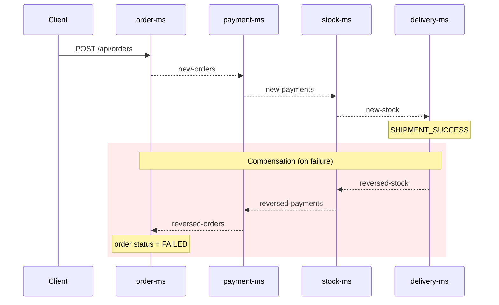

# spring-boot-distributed-transaction

[](https://github.com/hendisantika/spring-boot-distributed-transaction/actions/workflows/maven.yml)


[](LICENSE)

Spring Boot Distributed Transaction — a sample implementation of the **Saga pattern (choreography)** across four
microservices that communicate through **Apache Kafka**. Every service owns its own (in-memory H2) database; when a
step fails, compensating events are published to roll back the previous steps.

## Tech Stack

| Component        | Version / Tool                                              |
|------------------|-------------------------------------------------------------|
| Java             | **25** (Temurin / Corretto)                                 |
| Spring Boot      | 4.1.x (`spring-boot-starter-web`, `data-jpa`, `kafka`)      |
| JSON             | Jackson 3 (`tools.jackson`) + `JacksonJsonSerializer`       |
| Messaging        | Apache Kafka                                                |
| Database         | H2 (in-memory, one per service)                             |
| Build            | Maven (wrapper included in every service)                   |
| CI / Maintenance | GitHub Actions (matrix build per service) + Dependabot      |

## Services

| Service       | Port | Responsibility                                | REST endpoint         |
|---------------|------|-----------------------------------------------|-----------------------|
| `order-ms`    | 8080 | Create orders, mark order `FAILED` on reverse | `POST /api/orders`    |
| `payment-ms`  | 8081 | Process / reverse payments                    | –                     |
| `stock-ms`    | 8082 | Update / reverse warehouse stock              | `POST /api/addItems`  |
| `delivery-ms` | 8083 | Ship the order                                | –                     |

## Saga Flow



### Kafka Topics

| Topic               | Producer                   | Consumer      |
|---------------------|----------------------------|---------------|
| `new-orders`        | order-ms                   | payment-ms    |
| `new-payments`      | payment-ms                 | stock-ms      |
| `new-stock`         | stock-ms                   | delivery-ms   |
| `reversed-stock`    | delivery-ms                | stock-ms      |
| `reversed-payments` | stock-ms                   | payment-ms    |
| `reversed-orders`   | payment-ms                 | order-ms      |

## Getting Started

### Prerequisites

- JDK 25
- Maven 3.9+ (or use the bundled `./mvnw`)
- A running Kafka broker (local `localhost:9092` or a managed one)

### 1. Start Kafka locally (optional)

```shell
docker run -d --name kafka -p 9092:9092 apache/kafka:latest
```

Then point each service to it in `src/main/resources/application.properties`:

```properties
spring.kafka.bootstrap-servers=localhost:9092
```

> Using a managed broker (e.g. SASL_SSL/SCRAM)? Keep the `spring.kafka.properties.*` entries and provide the
> credentials through environment variables (`UPSTASH_USERNAME`, `UPSTASH_PASSWORD`) — never commit secrets.

### 2. Build & test

```shell
for svc in delivery-ms order-ms payment-ms stock-ms; do
  mvn -B package --file ./$svc/pom.xml
done
```

The `contextLoads` tests do not need a running broker (Kafka listeners are not auto-started in tests).

### 3. Run the services

Open four terminals and run:

```shell
cd stock-ms    && ./mvnw spring-boot:run
cd payment-ms  && ./mvnw spring-boot:run
cd delivery-ms && ./mvnw spring-boot:run
cd order-ms    && ./mvnw spring-boot:run
```

### 4. Try it

Add stock first:

```shell
curl -X POST http://localhost:8082/api/addItems \
  -H 'Content-Type: application/json' \
  -d '{"item": "books", "quantity": 100}'
```

Create an order:

```shell
curl -X POST http://localhost:8080/api/orders \
  -H 'Content-Type: application/json' \
  -d '{"item": "books", "quantity": 2, "amount": 150000, "paymentMode": "credit", "address": "Bandung"}'
```

- Omit `address` → delivery fails and the whole saga is compensated (order becomes `FAILED`).
- Order an item that has no stock → stock step fails and payment + order are reversed.

Each service uses its own in-memory H2 database (`ordersdb`, `paymentsdb`, `stockdb`, `deliverydb`), so data is reset
on restart.

## CI/CD & Dependency Management

- **GitHub Actions** ([`maven.yml`](.github/workflows/maven.yml)): builds & tests each service in parallel on JDK 25
  and submits the Maven dependency graph to GitHub on every push to `main`.
- **Dependabot** ([`dependabot.yml`](.github/dependabot.yml)):
  - one grouped PR per update across **all** services (Spring vs. other dependencies),
  - Spring Boot major upgrades are ignored (they need a manual migration),
  - GitHub Actions are updated weekly in a single grouped PR,
  - PRs are labeled and use conventional commit prefixes (`chore(deps)`, `ci(deps)`).

## Author

**Hendi Santika** — [s.id/hendisantika](https://s.id/hendisantika) · Telegram [@hendisantika34](https://t.me/hendisantika34)

## License

[MIT](LICENSE)
